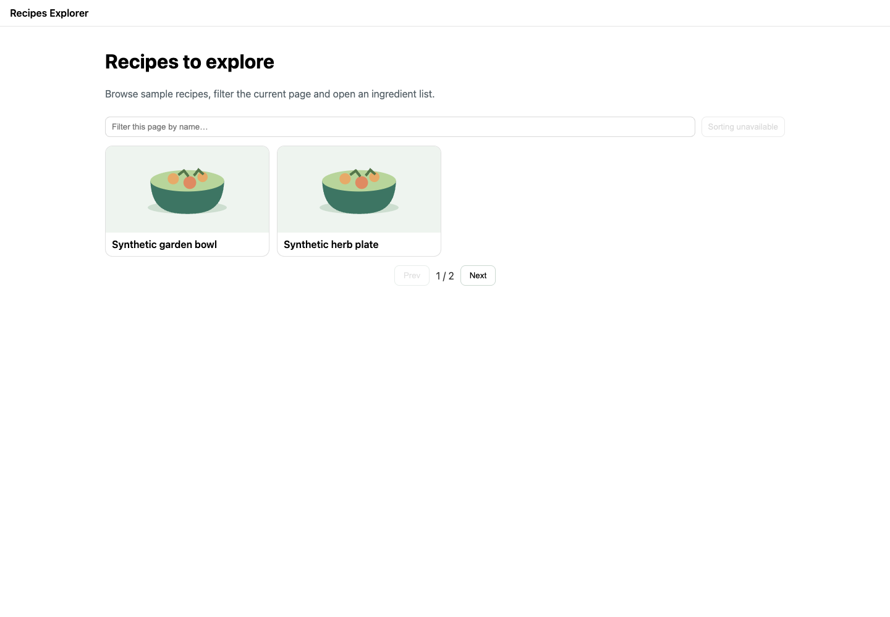
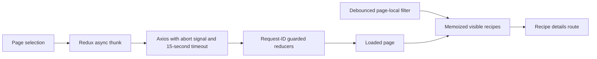

# Recipes Explorer

A React 19/Redux Toolkit client for browsing recipe pages and opening ingredient/instruction details from DummyJSON. It began as a live frontend exercise; the [original brief](TASK.md) is retained as context, while this README describes the implemented behavior.



[390px mobile preview](docs/screenshots/mobile.png). The screenshots use synthetic names and an original SVG illustration, not live recipe photographs.

## Try it locally

Use Node 22:

```sh
npm ci --ignore-scripts
npm run dev
```

Rsbuild serves `http://localhost:3000`. No account, database or API key is required. The app requests `https://dummyjson.com/recipes?limit=10&skip=…` and `/recipes/{id}`; [DummyJSON documents the recipe fields](https://dummyjson.com/docs/recipes). Normal use depends on that public sample-data service.

```sh
npm test
npm run build
npm run preview
```

Production hosting must route client-side paths such as `/recipes/1` back to `index.html`.

## Deliberate scope

The filter searches **only the currently loaded page**, case-insensitively. It does not search the whole catalog or change pages while typing. Pagination remains available even if the filter hides every item on the current page. Sorting is visibly disabled rather than exposing a no-op menu. URL query synchronization, favorites and normalized caching are not implemented.



List/detail requests propagate cancellation signals; component cleanup aborts pending work. Reducers accept only the active request ID, so a late response or failure cannot replace a newer result or repopulate cleared details. The visible-list selector retains its reference when its inputs are unchanged.

Details render ingredients and instructions instead of dumping JSON. The optional overview dialog opens on request; malformed recipe IDs produce a recovery link. Failed list/detail requests have retry controls, and failed list images use a local placeholder.

## Evidence and limits

Five Vitest tests pass for stale list success/failure, abort propagation, cleared detail state and page-local filtering/memoization. The Rsbuild production bundle passes. Chrome/Playwright verified synthetic list/detail navigation, filtering, pagination after a filtered-empty page, the overview dialog and desktop/390px layouts. No live data API call was needed for those checks; tests mock responses.

The first npm installation hit npm 10's dependency resolver error. Regenerating/installing the lock with npm 11 resolved it, and a subsequent ordinary `npm ci --ignore-scripts` passed. Runtime framework versions were preserved. Rsbuild still emits a module-format warning for its existing configuration, and no separate full-project TypeScript checker is configured.

The API response type is a development contract rather than full runtime schema validation. There is no server-side search, authentication, persistence or image cropping despite some unused legacy UI dependencies. The next useful decisions are whether search should cover the entire catalog, whether list state belongs in the URL, and whether unused packages should be removed. For this small app, those are more proportionate than adding a database or distributed cache.
